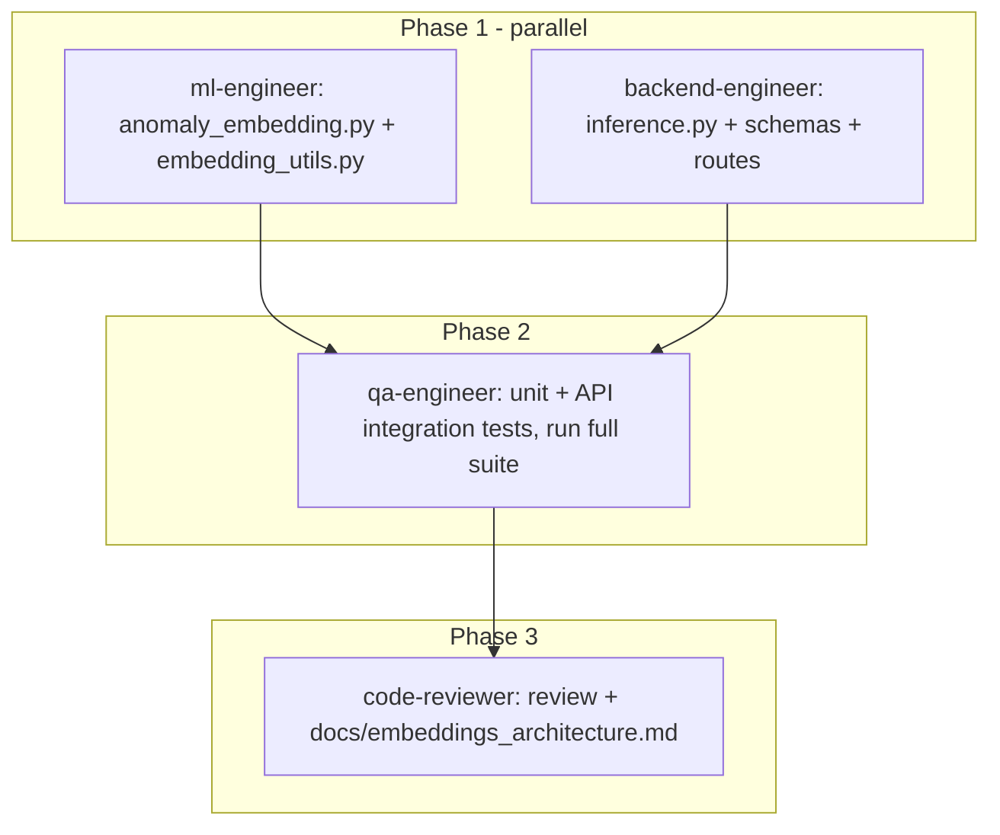

# Implement Gap 1: Vector Embeddings for Anomalies

Source spec: [implementation plan/Phase 1.9/IMPLEMENTATION_GAP_1_VECTOR_EMBEDDINGS.md](implementation plan/Phase 1.9/IMPLEMENTATION_GAP_1_VECTOR_EMBEDDINGS.md)

All subagents will run on **Fable 5** (`claude-fable-5-thinking-high`) per your instruction.

## Adaptations of the spec to the real codebase

The gap doc was written against an older imagined structure. Key deviations I will apply:

- The real [src/api/schemas/sensor_data.py](src/api/schemas/sensor_data.py) `InferenceResponse` uses `tenant_id`/`greenhouse_id` (not the spec's `model_id`/`customer_id`). New fields `embeddings`, `uncertainties`, `embedding_dim` will be added as **Optional** to preserve backward compatibility with existing API tests.
- The real [src/models/inference.py](src/models/inference.py) already has `AnomalyDetector` (model-cache, used by the route via `get_cached_detector`). Instead of the spec's separate `AnomalyDetectorWithEmbeddings` class, I'll add an enriched path on `AnomalyDetector` (`predict_with_embeddings` / `predict_batch_enriched`) that reuses one forward pass for score + mu/logvar — keeping the existing `predict`/`predict_batch` contract untouched.
- `datetime.utcnow()` in the spec is deprecated; use `datetime.now(timezone.utc)`.
- While editing [src/api/routes/inference.py](src/api/routes/inference.py), fix the existing duplicated `detector.predict_batch(np_seqs)` call (lines 65-67) since one forward pass will now produce scores and embeddings together.
- `scipy` is only a transitive dep today; it will be pinned explicitly in [requirements.txt](requirements.txt).

## Execution plan (agent dependency graph)

### Phase 1 (parallel, both on Fable 5)

**ml-engineer** — new model-layer modules (owns `src/models/`):

- `src/models/anomaly_embedding.py`: `AnomalyEmbedding` class per spec — `embed_sequence`, `embed_batch`, `embed_with_uncertainty`, `embedding_distance` (cosine/euclidean), `embedding_similarity`, `cluster_embeddings` (KMeans), `decode_embedding`; plus `EnrichedAnomalyResult` dataclass with `to_dict()`. Embedding = encoder `mu` (8-dim, `LATENT_DIM` from config).
- `src/models/embedding_utils.py`: `normalize_embeddings`, `embedding_statistics`, `find_nearest_embeddings`, `embedding_projection_2d` (t-SNE, optional UMAP fallback) per spec.
- Add `scipy` pin to `requirements.txt`.

**backend-engineer** — integration (owns `src/api/`, `src/models/inference.py`):

- Extend `AnomalyDetector` with an enriched batch method returning `(scores, embeddings, uncertainties)` from a single forward pass.
- Add Optional `embeddings: List[List[float]]`, `uncertainties: List[float]`, `embedding_dim: int` fields to `InferenceResponse`.
- Update `POST /inference` (and the CSV upload route) to populate the new fields; remove the duplicate predict call.

### Phase 2 — qa-engineer (Fable 5), receives Phase 1 outputs as context

- `tests/models/test_anomaly_embedding.py` per the spec's test plan (shape contracts, distance/similarity identities, clustering, decode round-trip) + tests for `embedding_utils`.
- `tests/api/test_inference_with_embeddings.py`: response contains embeddings of correct dim, uncertainties, backward compatibility of existing fields.
- Run the full suite; everything must stay green (existing API tests in `tests/api/` must not break).

### Phase 3 — code-reviewer (Fable 5)

- Review all new/changed code; write `docs/embeddings_architecture.md` (design, latent-space rationale, API contract, usage examples).

### Final verification (orchestrator)

- Independently re-run `python3 -m pytest tests/ -q` + coverage, lint check, update `AGENT_MEMORY.md`.

## Out of scope (per spec's own checklist, deferred)

- Dashboard embedding visualization (t-SNE page in `src/dashboard/`) — flagged as follow-up, not blocking Gap 1.
- pgvector incident memory (that is Gap 2).

## Note

There is a junk file literally named `src/api/routes/upload.py,src/api/routes/inference.py,...` (commas in filename) in the repo — I'll delete it during cleanup unless you object.
