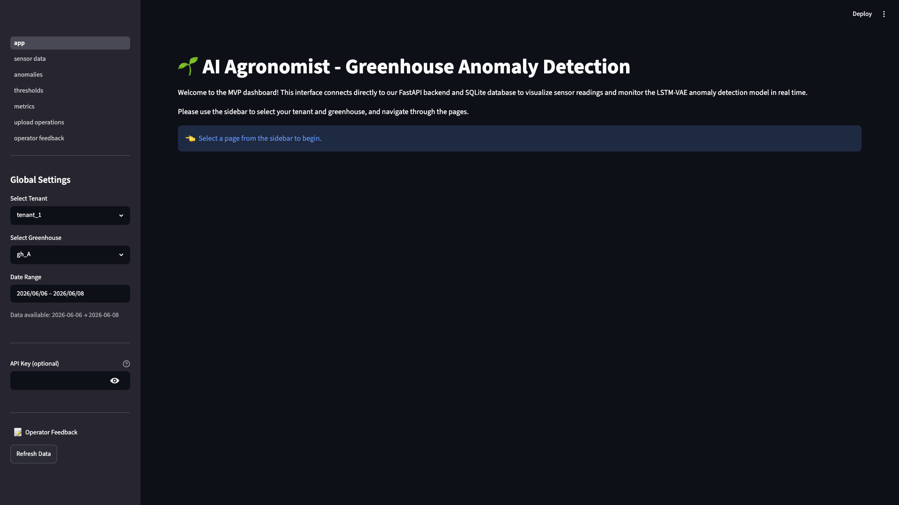
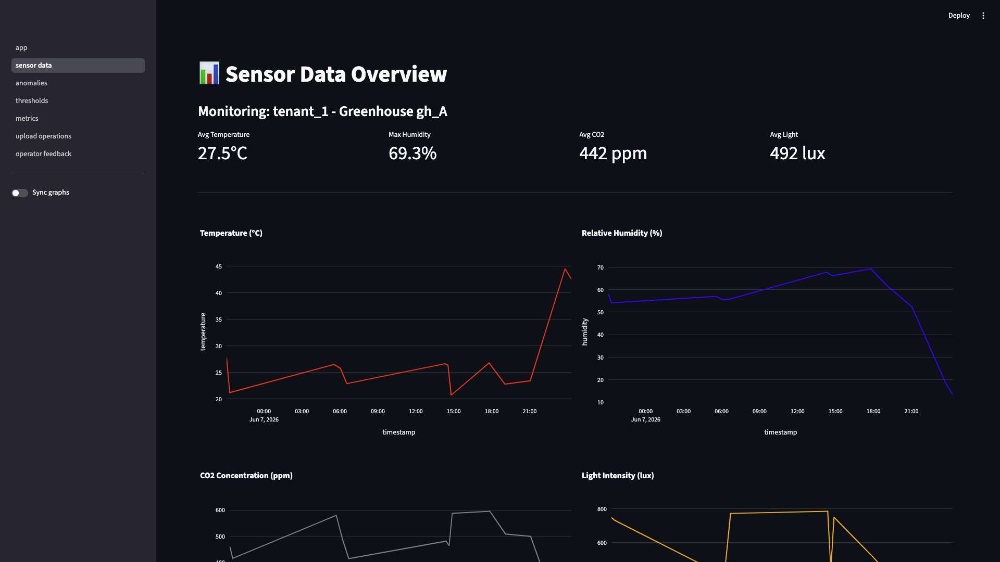
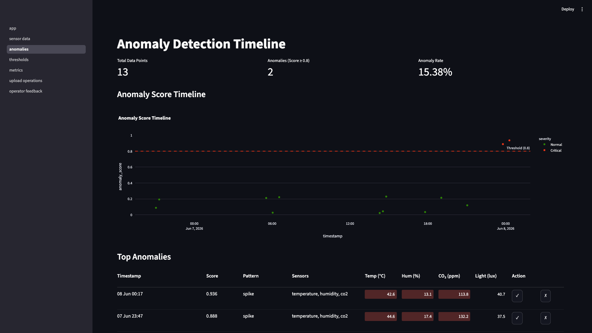
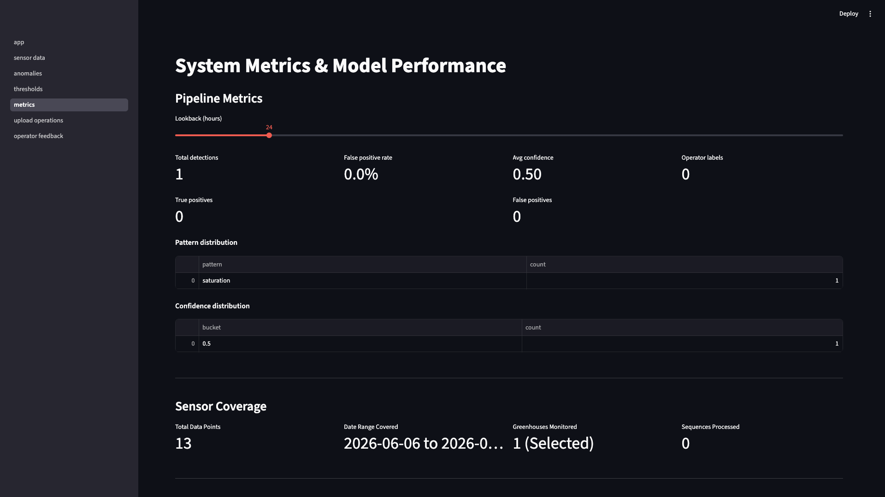
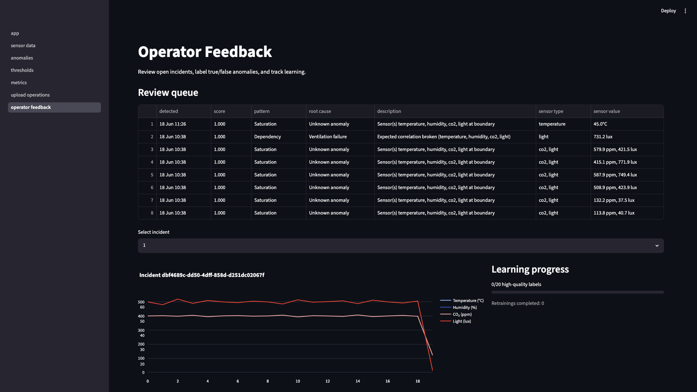
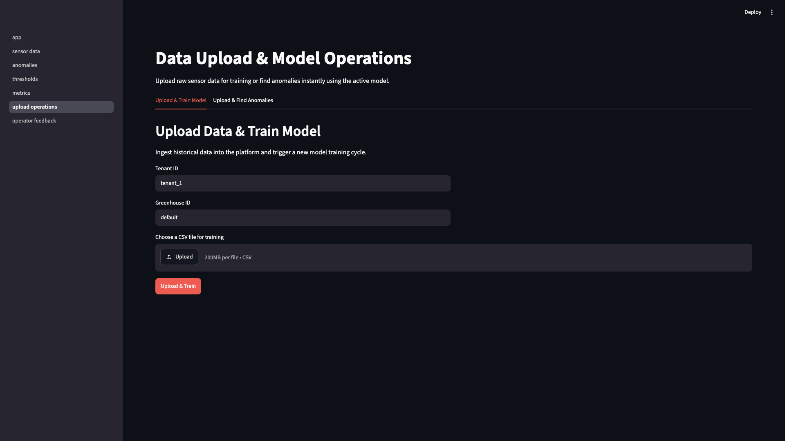
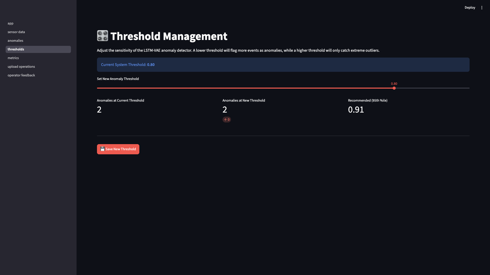
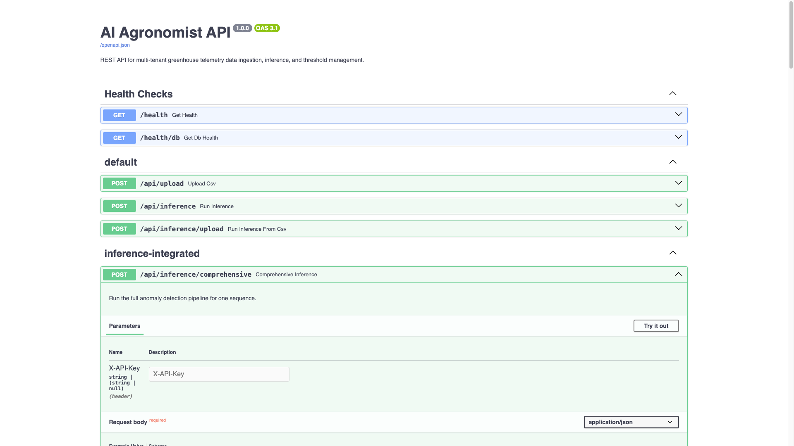

# AI Agronomist — Visual User Guide

**Last updated:** 2026-06-18  
**Dashboard:** http://127.0.0.1:8501 · **API docs:** http://127.0.0.1:8000/docs

Step-by-step guide to every dashboard page and the API. Each section shows a screenshot in context, then explains the controls and what you can do on that page.

Setup commands and curl examples: [USER_GUIDE.md](USER_GUIDE.md)

> Open **Markdown Preview** (`⌘⇧V`) to see inline screenshots. Images are in `./images/user-guide/` relative to this file.

---

## Table of contents

1. [Before you start](#1-before-you-start)
2. [Home (`app`) — global settings](#2-home-app--global-settings)
3. [Sensor Data](#3-sensor-data)
4. [Anomalies](#4-anomalies)
5. [Metrics](#5-metrics)
6. [Operator Feedback](#6-operator-feedback)
7. [Upload Operations](#7-upload-operations)
8. [Thresholds](#8-thresholds)
9. [API reference (Swagger)](#9-api-reference-swagger)
10. [End-to-end workflow](#10-end-to-end-workflow)
11. [Troubleshooting](#11-troubleshooting)

---

## 1. Before you start

Start both services before using the dashboard:

```bash
# Terminal 1 — API (required for Operator Feedback + Metrics)
venv/bin/python -m uvicorn src.api.main:app --reload --host 127.0.0.1 --port 8000

# Terminal 2 — Dashboard
venv/bin/python -m streamlit run src/dashboard/app.py
```

**First visit:** always open the **Home (`app`)** page and set tenant, greenhouse, and date range. Every other page reads those values from session state. If you skip this step, sub-pages show *"Please configure global settings in the sidebar of the main app."*

---

## 2. Home (`app`) — global settings

**Navigate:** http://127.0.0.1:8501 (default landing page)

### What this page is about

The home page is the **control centre** for the whole dashboard. It does not show charts itself — it sets which tenant, greenhouse, and date range all other pages use. Think of it as the filter panel you configure once, then explore the other pages.

### Screenshot



### Controls available

| Control | Location | What it does |
|---------|----------|--------------|
| **Page navigation** | Sidebar top | Links to sensor data, anomalies, thresholds, metrics, upload operations, operator feedback |
| **Select Tenant** | Global Settings | Chooses customer scope (`tenant_1`, `tenant_2`, …). All queries filter to this tenant. |
| **Select Greenhouse** | Global Settings | Chooses greenhouse within the tenant (`gh_A`, `gh_B`, …). |
| **Date Range** | Global Settings | Limits charts and tables to a start/end date. |
| **Data available** | Caption below date picker | Shows actual min/max dates in the database for the current tenant/greenhouse. |
| **API Key (optional)** | Global Settings | Sent as `X-API-Key` header when API auth is enabled. |
| **Operator Feedback** | Sidebar link | Shortcut to the review queue page. |
| **Refresh Data** | Sidebar button | Clears cached sensor queries and reloads all pages. |

### What you can do

1. **Select your tenant and greenhouse** before exploring any data page.
2. **Set the date range** to match the period you want to analyse (use the "Data available" hint).
3. **Enter an API key** if your FastAPI server has `AUTH_ENABLED=true`.
4. **Pick a page** from the sidebar to start working — sensor charts, anomalies, labelling, etc.

---

## 3. Sensor Data

**Navigate:** sidebar → **sensor data**

### What this page is about

Shows **historical sensor readings** as time-series charts for the tenant/greenhouse/date range you selected on the Home page. Use it to visually inspect normal operation, spot unusual periods, and confirm that CSV uploads landed in the database.

### Screenshot



### Controls available

| Control | What it does |
|---------|--------------|
| **Summary metrics** (top row) | Avg Temperature, Max Humidity, Avg CO₂, Avg Light for the filtered date range |
| **Temperature chart** | Line chart of °C over time |
| **Humidity chart** | Line chart of % over time |
| **CO₂ chart** | Line chart of ppm over time |
| **Light chart** | Line chart of lux over time |
| **Sync graphs** (toggle) | When on, all four charts share the same x-axis so you can compare sensors at the same moment |
| **Plotly toolbar** (top-right of each chart) | Zoom, pan, download PNG, fullscreen |

Global sidebar settings (tenant, greenhouse, date range) apply here automatically.

### What you can do

1. **Verify a CSV upload** — after uploading on Upload Operations, come here and confirm data appears in the charts.
2. **Inspect trends** — look for sudden spikes or drops across temperature, humidity, CO₂, and light.
3. **Compare sensors** — enable **Sync graphs** and zoom into a suspicious time window.
4. **Check summary stats** — the four metric cards give a quick health snapshot for the period.

---

## 4. Anomalies

**Navigate:** sidebar → **anomalies**

### What this page is about

Shows **detected anomalies** from the LSTM-VAE model as a timeline scatter plot and a ranked table of the top 20 highest-scoring readings. Sensor cells are colour-highlighted when that sensor drove the anomaly. This page reads from the local database — it shows scored sensor readings, not full diagnosis incidents.

### Screenshot



### Controls available

| Control | What it does |
|---------|--------------|
| **Total Data Points** | Count of readings in the filtered date range |
| **Anomalies (Score ≥ threshold)** | How many readings exceed the anomaly threshold |
| **Anomaly Rate** | Percentage of readings flagged |
| **Timeline chart** | Each dot = one reading's anomaly score over time. Green = normal, red = critical. Dashed red line = threshold (default 0.80). |
| **Top Anomalies table** | Top 20 rows sorted by score — timestamp, score, pattern, affected sensors, sensor values |
| **ℹ icon** (per row) | Hover/click for diagnosis popup — pattern, root cause, detector scores (when linked to an incident) |
| **✓ / ✗ buttons** (per row) | Quick feedback — confirm true anomaly or mark false positive (requires linked incident) |
| **Colour-highlighted cells** | Temp / Hum / CO₂ / Light cells tinted when that sensor contributed to the anomaly |

Threshold value comes from the **Thresholds** page (default 0.80).

### What you can do

1. **Scan the timeline** — red dots above the dashed line are your highest-priority events.
2. **Review the top table** — see which sensors and patterns are involved in each event.
3. **Open row diagnosis** — click **ℹ** on a row for root cause and recommendations.
4. **Submit quick feedback** — use **✓** or **✗** when the row is linked to an incident.
5. **Move to Operator Feedback** — for full labelling with sequence chart and learning loop, register incidents first (see §6 and §10).

> **Note:** Rows here are **sensor readings with scores**. They appear in **Operator Feedback** only after comprehensive inference creates an **incident** for them.

---

## 5. Metrics

**Navigate:** sidebar → **metrics**

### What this page is about

Two panels: **Pipeline Metrics** pulls live observability data from the FastAPI monitoring API (`GET /api/monitoring/metrics`). **Sensor Coverage** shows local database stats — how much sensor data exists for your selected tenant/greenhouse. Use this page to track detection volume, false-positive rate, and operator labelling activity.

### Screenshot



### Controls available

| Control | What it does |
|---------|--------------|
| **Lookback (hours) slider** | Sets the `hours` query param for the monitoring API (1–168, default 24) |
| **Total detections** | Number of comprehensive pipeline runs in the lookback window |
| **False positive rate** | Operator-marked false positives ÷ total detections |
| **Avg confidence** | Mean confidence score across detections |
| **Operator labels** | Total true + false positive labels submitted |
| **True positives / False positives** | Breakdown of operator feedback counts |
| **Pattern distribution table** | Count per pattern type (drift, spike, saturation, dependency, …) |
| **Confidence distribution table** | Histogram of confidence score buckets |
| **Sensor Coverage section** | Total data points, date range covered, greenhouses monitored, sequences processed (from local DB) |

Requires the **FastAPI server running** on port 8000. If unreachable, a warning with a link to the ops runbook is shown.

### What you can do

1. **Monitor pipeline health** — check detection count and average confidence after running comprehensive inference.
2. **Track operator feedback impact** — watch true/false positive counts grow as you label incidents.
3. **Adjust lookback** — slide to 1 hour for recent activity or 72+ hours for weekly trends.
4. **Review pattern breakdown** — see which anomaly types dominate (e.g. saturation vs spike).
5. **Confirm data ingestion** — use Sensor Coverage to verify uploads even when pipeline metrics are still zero.

To populate pipeline metrics, run at least one comprehensive inference:

```bash
curl -s -X POST http://127.0.0.1:8000/api/inference/comprehensive \
  -H "Content-Type: application/json" \
  -d @fixtures/comprehensive_request.json
```

---

## 6. Operator Feedback

**Navigate:** sidebar → **operator feedback** (or the sidebar shortcut on the Home page)

### What this page is about

The **operator labelling queue**. Lists open incidents from the API, lets you inspect the full 20-step sensor sequence and AI diagnosis, and submit **True anomaly** or **False positive** labels. Labels feed active learning — at 20 high-quality labels the system auto-retrains with promote/rollback.

Requires **both** the dashboard and the FastAPI API running.

### Screenshot



### Controls available

| Control | What it does |
|---------|--------------|
| **Review queue table** | All open incidents — detected time, score, pattern, root cause, affected sensors |
| **Pending anomalies banner** | Shown when sensor readings are flagged but not yet registered as incidents |
| **Register all for review** (button) | Runs comprehensive inference on pending anomalies to create incidents |
| **Select incident** (dropdown) | Pick which incident to inspect and label |
| **Sequence chart** | 20-timestep plot of all 4 sensors (temperature, humidity, CO₂, light) |
| **Diagnosis card** | Pattern, attribution, root cause, recommendations, detector scores, ensemble agreement |
| **True anomaly** (button) | Confirms the detection — counts as a true positive for learning |
| **False positive** (button) | Rejects the detection — counts as a false positive, updates FP rate in Metrics |
| **Learning progress panel** | Shows `X/20 high-quality labels` and retrainings completed |

Global sidebar **API Key** is used for authenticated API calls.

### What you can do

1. **Review the queue** — scan open incidents sorted by detection time and score.
2. **Register pending anomalies** — if Anomalies page shows events but the queue is empty, click **Register all for review**.
3. **Inspect an incident** — select from dropdown, read the sequence chart and diagnosis card.
4. **Label the incident** — click **True anomaly** or **False positive**.
5. **Track learning** — watch the progress bar advance toward the retrain threshold (20 labels).
6. **Verify in Metrics** — after labelling, check true/false positive counts on the Metrics page.

Typical flow: comprehensive inference creates an incident → it appears here → you label → metrics and learning progress update.

---

## 7. Upload Operations

**Navigate:** sidebar → **upload operations**

### What this page is about

**Data ingestion** — upload a CSV of sensor readings to the database, then either train a model or run batch anomaly detection. This is the primary way to get real greenhouse data into the system without using curl.

### Screenshot



### Controls available

| Control | What it does |
|---------|--------------|
| **Upload & Train Model** (tab) | Ingest CSV and trigger LSTM-VAE training for the tenant |
| **Upload & Find Anomalies** (tab) | Ingest CSV and run batch inference to score readings |
| **Tenant ID** | Target tenant for the upload (match sidebar selection, e.g. `tenant_1`) |
| **Greenhouse ID** | Target greenhouse (match sidebar, e.g. `gh_A`) |
| **Choose a CSV file** | File picker — max 200 MB, CSV only |
| **Upload & Train** (button) | Sends file to API, stores readings, starts training |
| **Upload & Find Anomalies** (button) | Sends file to API, stores readings, runs inference |

### CSV format required

Header row (exact column names):

```csv
timestamp,temperature,humidity,co2,light
2026-06-09T11:00:00Z,24.5,50.2,400.0,1200.0
```

| Column | Valid range |
|--------|-------------|
| `timestamp` | ISO 8601 UTC (e.g. `2026-06-09T11:00:00Z`) |
| `temperature` | 0–50 °C |
| `humidity` | 0–100 % |
| `co2` | 0–1000 ppm |
| `light` | 0–2000 lux |

Example file: `data/synthetic_customers/customer_tomato/normal.csv`

### What you can do

1. **Upload historical data** — pick a CSV, set tenant/greenhouse, click **Upload & Train** or **Upload & Find Anomalies**.
2. **Verify on Sensor Data** — switch to the Sensor Data page and confirm charts populate.
3. **Check anomalies** — after "Find Anomalies", open the Anomalies page to see scored events.
4. **Continue to labelling** — register incidents via Operator Feedback or comprehensive inference.

---

## 8. Thresholds

**Navigate:** sidebar → **thresholds**

### What this page is about

Adjusts the **anomaly detection sensitivity** for the dashboard. The threshold controls which readings appear as anomalies on the Anomalies page (score ≥ threshold). A preview shows how many events would be flagged at the current vs proposed value before you save.

### Screenshot



### Controls available

| Control | What it does |
|---------|--------------|
| **Current System Threshold** (banner) | Active threshold value (default **0.80**) |
| **Set New Anomaly Threshold** (slider) | Drag to preview a new value (0.0–1.0) |
| **Anomalies at Current Threshold** | Count of readings ≥ current threshold |
| **Anomalies at New Threshold** | Count at the slider value — shows delta badge |
| **Recommended (95th %ile)** | Data-driven suggestion from your sensor scores |
| **Save New Threshold** (button) | Applies the slider value to session — affects Anomalies page immediately |

### What you can do

1. **See current impact** — check how many anomalies the active threshold catches.
2. **Preview changes** — drag the slider and compare counts before saving.
3. **Use the recommendation** — align with the 95th percentile if you want a data-driven default.
4. **Save** — click **Save New Threshold**, then revisit Anomalies to see the updated count.
5. **Tune sensitivity** — lower threshold = more alerts (noisier); higher = fewer alerts (stricter).

---

## 9. API reference (Swagger)

**Navigate:** http://127.0.0.1:8000/docs (separate browser tab)

### What this page is about

Interactive **OpenAPI (Swagger) documentation** for the FastAPI backend. Use it to explore every endpoint, read request/response schemas, and execute test calls directly in the browser — no curl required.

### Screenshot



### Key endpoint groups

| Tag | Endpoints | When to use |
|-----|-----------|-------------|
| **inference-integrated** | `POST /api/inference/comprehensive`, `POST /api/inference/batch` | Full diagnosis pipeline for one or many sequences |
| **feedback-integrated** | `POST /api/feedback/mark-anomaly` | Operator label → active learning |
| **monitoring** | `GET /api/monitoring/metrics` | Pipeline observability (same data as Metrics page) |
| **incidents** | `GET /open`, `GET /{id}`, `GET /similar`, … | Incident memory and review queue |
| **feedback** | `GET /learning-progress/{customer_id}` | Retrain progress |
| **default** | `POST /api/upload`, `POST /api/inference` | CSV ingest and basic inference |

### What you can do

1. **Run comprehensive inference** — expand `POST /api/inference/comprehensive` → **Try it out** → paste body from `fixtures/comprehensive_request.json` → **Execute**.
2. **Copy the `incident_id`** from the response.
3. **Submit feedback** — expand `POST /api/feedback/mark-anomaly` → paste incident ID and label.
4. **Check metrics** — expand `GET /api/monitoring/metrics` → set `hours` → **Execute**.
5. **Explore schemas** — scroll to the **Schemas** section for full request/response field lists.

---

## 10. End-to-end workflow

Typical operator path from raw data to model improvement:

```
Upload CSV  →  Sensor Data (verify)  →  Comprehensive inference  →  Operator Feedback (label)  →  Metrics (monitor)
```

### Step-by-step

| Step | Page / action | Goal |
|------|---------------|------|
| 1 | **Home** — set tenant, greenhouse, date range | Configure global filters |
| 2 | **Upload Operations** — upload CSV | Ingest sensor readings |
| 3 | **Sensor Data** — check charts | Confirm data landed correctly |
| 4 | **Comprehensive inference** — Operator Feedback → Register all, or Swagger/curl | Create diagnosed incidents |
| 5 | **Anomalies** — review timeline + table | Spot highest-score events |
| 6 | **Operator Feedback** — label true/false | Close the learning loop |
| 7 | **Metrics** — check FP rate, pattern distribution | Monitor pipeline health |
| 8 | **Thresholds** — tune if too many/few alerts | Adjust sensitivity |

Smoke-test curl (creates one incident for `tenant_1`):

```bash
curl -s -X POST http://127.0.0.1:8000/api/inference/comprehensive \
  -H "Content-Type: application/json" \
  -d @fixtures/comprehensive_request.json
```

---

## 11. Troubleshooting

| Symptom | Likely cause | Fix |
|---------|--------------|-----|
| *"Configure global settings"* on a sub-page | Home page not visited | Open **Home (`app`)**, set tenant + greenhouse |
| Operator Feedback shows API error | FastAPI not running | Start uvicorn on port 8000 |
| Anomalies has rows, Feedback queue empty | Readings ≠ incidents | **Register all for review** or run comprehensive inference |
| Metrics pipeline section empty/warning | No comprehensive runs yet | POST to `/api/inference/comprehensive` |
| Metrics pipeline section empty/warning | API unreachable | Check port 8000, enter API key if auth enabled |
| Charts empty on Sensor Data | Wrong tenant/greenhouse/dates | Match sidebar to uploaded data; check "Data available" |
| Upload fails with 422 | Wrong CSV columns | Use exact header: `timestamp,temperature,humidity,co2,light` |
| Screenshots not visible in editor | Preview not open | Press `⌘⇧V` (Markdown Preview) — images are inline above in each section |

---

## Related docs

- [USER_GUIDE.md](USER_GUIDE.md) — setup, migrations, curl reference
- [deployment/phase-4.1-deployment-checklist.md](deployment/phase-4.1-deployment-checklist.md) — staging/production
- [deployment/monitoring-dashboard-config.yaml](deployment/monitoring-dashboard-config.yaml) — alert thresholds
- [RELEASE_NOTES.md](RELEASE_NOTES.md) — feature history
