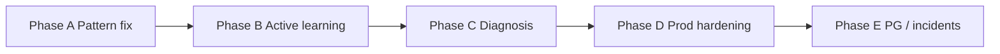

# Fix Plan — Deferred Bugs & Notes

**Created:** 2026-06-15  
**Scope:** Post Phase 1.9.1 cleanup before production deployment  
**Bug index:** [../bugs/README.md](../bugs/README.md)  
**Notes index:** [../notes/README.md](../notes/README.md)

---

## Priority summary

| Phase | Focus | Bugs | Est. effort | Blocker for prod? |
|-------|-------|------|-------------|-------------------|
| **A** | Quick wins | BUG-001 | 2h | No | **Done** 2026-06-15 |
| **B** | Active learning cleanup | BUG-003, 004, 005 + NOTE-AL-001 | 1 day | No | **Done** 2026-06-15 |
| **C** | Diagnosis quality | BUG-006, BUG-009 + NOTE-RC-003 | 1 day | No | **Done** 2026-06-15 |
| **D** | Production hardening | BUG-007, BUG-008 | 3–5 days | **Yes** | **Done** 2026-06-15 |
| **E** | Incident memory / PG | BUG-010, BUG-011 + NOTE-IM-* | 2 days | PG deploy only | **Done** 2026-06-15 |

---

## Phase A — Pattern Detector fix (immediate)

**Goal:** Close longest-standing open bug with one-line fix.

### Tasks

1. Apply `np.atleast_2d` in `_safe_corrcoef` ([BUG-001](../bugs/BUG-001-pattern-detector-single-sensor-crash.md))
2. Promote xfail test to passing
3. Add 2-sensor regression test (NOTE-PD-003)
4. Run gate: `pytest tests/models/test_pattern_detector.py` + full 441 gate

### Owner

ml-engineer

### Done when

- 0 xfailed in pattern detector suite (or xfail count reduced by 1)
- BUG-001 marked Closed in bugs README

---

## Phase B — Active learning consistency

**Goal:** Single quality concept, accurate stats, dampening for new operators.

### Tasks

| # | Bug/Note | Action |
|---|----------|--------|
| 1 | BUG-004 | Remove `quality_score` + `get_high_quality()` OR wire to validator |
| 2 | BUG-003 | Build `operator_reliability` from validator keys |
| 3 | BUG-005 | Add low-count dampening + config constant |
| 4 | NOTE-AL-001 | Parametrized tests for `validate_and_promote(inf/nan)` |

### Files

- `src/models/feedback_collector.py`
- `src/models/feedback_validator.py`
- `src/models/active_learner.py`
- `src/config.py`
- `tests/models/test_active_learner.py`

### Owner

ml-engineer → qa-engineer (90% cov)

### Done when

- Coverage doc updated
- bugs README: BUG-003, 004, 005 → Closed

---

## Phase C — Diagnosis & attribution polish

**Goal:** Better operator-facing evidence; safer attributor init.

### Tasks

| # | Bug/Note | Action |
|---|----------|--------|
| 1 | BUG-006 | Map all 21 indicators; fallback for unknown |
| 2 | BUG-009 | Atomic baseline assignment in attributor |
| 3 | NOTE-RC-003 | Split `DIAGNOSIS_RULES` to `diagnosis_rules.py` (optional, keeps file <300 lines) |
| 4 | NOTE-AA-001 | Write ADR for deterministic attribution scoring |

### Owner

ml-engineer → code-reviewer

### Done when

- `compressor_failure` has non-empty evidence in tests
- BUG-006, BUG-009 → Closed

---

## Phase D — Production hardening (required before prod)

**Goal:** Secure API and survive restarts.

### D1 — Authentication (BUG-007)

```
Week 1 of Phase D
```

1. Choose auth model: API key header (`X-API-Key`) or JWT with tenant claim
2. Add `src/api/middleware/auth.py` + dependency `get_current_tenant`
3. Protect all feedback + integrated inference routes
4. Add `AUTH_ENABLED` config flag (default False in dev, True in prod)
5. Tests: 401 without creds, 403 cross-tenant

**Estimate:** 2 days

### D2 — Persistent orchestrator state (BUG-008)

```
Week 2 of Phase D
```

1. Design: DB-backed `LearningState` table (customer_id, feedback JSON, validator stats, last_retrain)
2. Alembic migration `005_add_learning_state.py`
3. Refactor `_orchestrators` to load/save through repository
4. Integration test: feedback → simulated restart → state restored

**Estimate:** 2–3 days

### D3 — Integration notes (optional same sprint)

- NOTE-INT-001: LRU cache for `_pipeline_cache` (maxsize=16)
- ~~NOTE-INT-003: Dashboard widgets wiring~~ — **resolved 2026-06-15** (Metrics page + monitoring-dashboard-config.yaml)

### Owner

backend-engineer (auth) + ml-engineer (persistence)

### Done when

- BUG-007, BUG-008 → Closed
- Deployment checklist auth section ticked
- Security review PASS

---

## Phase E — PostgreSQL & incident memory

**Goal:** Confidence in pgvector production path.

### Tasks

| # | Bug/Note | Action |
|---|----------|--------|
| 1 | BUG-011 | `@pytest.mark.postgres` docker CI job |
| 2 | NOTE-IM-001 | Document ivfflat REINDEX in runbook |
| 3 | BUG-010 | Idempotent resolve_incident (409 on double-resolve) |
| 4 | NOTE-IM-005 | POST `/api/incidents/search` for large embeddings (optional) |

### Owner

devops-lead (CI) + backend-engineer (API)

### Done when

- [x] PG similarity test green in CI (`.github/workflows/postgres-tests.yml`)
- [x] BUG-010, BUG-011 → Closed

---

## Execution order (recommended)



**Parallel track:** Phase A can start immediately. Phase D should start before any production deploy regardless of A–C completion.

---

## Tracking

When closing a bug:

1. Update status in `docs/bugs/BUG-XXX-*.md` → **Closed** with date
2. Move row to "Closed" section in `docs/bugs/README.md`
3. Add one line to `AGENT_MEMORY.md` Completed Tasks
4. If fix touches tests, update relevant coverage doc

When addressing a note:

1. Strike through or mark **Resolved** in the note file
2. No need to delete — keep for audit trail

---

## Out of scope (notes only, no bug ticket)

These remain in [../notes/](../notes/) and can be picked up opportunistically:

- NOTE-PD-002 z-score deduplication
- NOTE-RC-001 config override for diagnosis confidences
- NOTE-CS-001 through CS-003 typing/doc improvements
- NOTE-IM-002 schema drift migration
- NOTE-IM-004 dead columns (wire up or drop in future phase)
