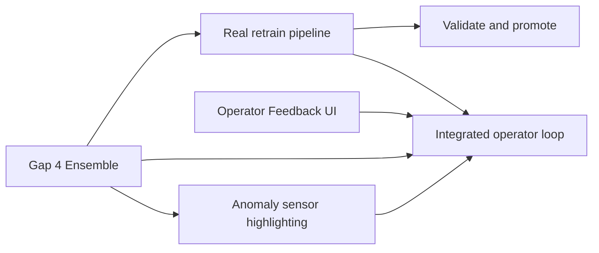
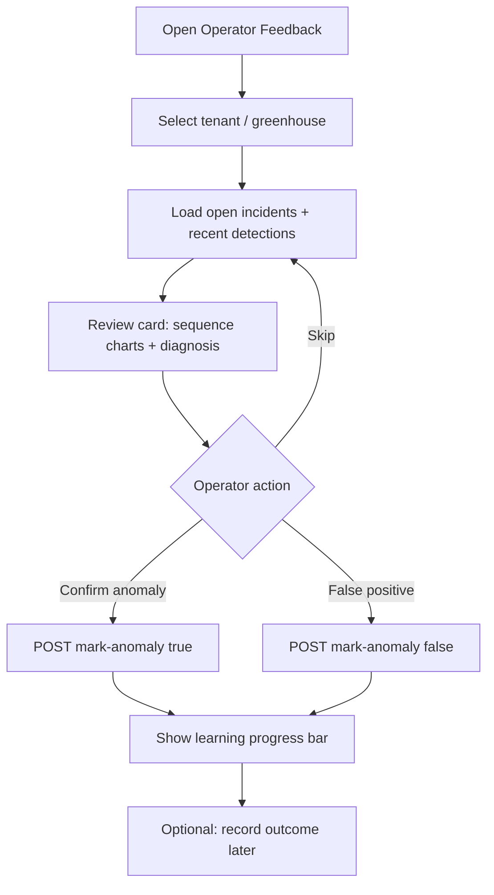

# Plan — Operator Feedback UI, Gap 4 Ensemble, Real Model Improvement

**Created:** 2026-06-15  
**Status:** Proposed  
**Depends on:** Phase 1.9.1 complete (comprehensive pipeline, active learning API, model registry, persistence)  
**Goal:** Close the loop from operator label → measurable model change → visible UI

---

## Executive summary

Three workstreams, one dependency chain:



| Track | Effort | Outcome |
|-------|--------|---------|
| **A — Gap 4 Ensemble** | 3–4 days | 4 detectors + weighted vote; feeds confidence scorer |
| **B — Real model improvement** | 3–4 days | Retrain actually updates weights/thresholds; promote/rollback |
| **C — Operator Feedback UI** | 3–5 days | Streamlit workflow: review → label → progress |
| **E — Anomaly sensor highlighting** | 2–3 days | Anomalies table: highlighted cells + hover hints |
| **D — Integration + QA** | 2 days | Pipeline + dashboard + tests + docs |

**Total:** ~13–17 days (2.5–3 weeks with review/QA)

---

## Current gaps (baseline)

| Area | Today | Target |
|------|-------|--------|
| Operator UI | API-only (`/docs`, curl) | Streamlit review queue + one-click label |
| Ensemble | `CONFIDENCE_ENSEMBLE_SIZE=4` stub in pipeline | 4 real detectors + agreement count |
| Retrain | `trigger_retraining()` simulated | Updates persisted config/checkpoints |
| Validation | `validate_and_promote()` exists, unused | Auto-eval after retrain; registry promote/rollback |
| Feedback data | `sequence=None` in collector | Sequence + incident metadata stored |
| Anomalies table | Plain numeric columns, no attribution | Highlighted sensor cells + hover explanation |

---

## Track A — Gap 4: Ensemble Anomaly Detection

**Reference:** `implementation plan/Phase 1.9/WEEK_BY_WEEK_IMPLEMENTATION_CHECKLIST.md` (Gap 4 section)

### A1 — Core module (`src/models/ensemble_detector.py`)

Implement four detectors behind a common protocol:

| Detector | Input | Score | Notes |
|----------|-------|-------|-------|
| `LstmVaeDetector` | sequence | recon error (existing) | Wrap `AnomalyDetector` |
| `IsolationForestDetector` | flattened sequence | IF score | sklearn; fit on customer baseline |
| `StatisticalDetector` | sequence | Mahalanobis | Per-sensor mean/cov from baseline |
| `CorrelationDetector` | sequence | physics violation score | Temp/humidity/CO₂/light bounds + correlation rules |

`EnsembleAnomalyDetector`:
- `detect(sequence, baseline) → EnsembleResult`
- Fields: `detector_scores: Dict[str, float]`, `ensemble_score: float`, `agreement_count: int`, `is_anomaly: bool`
- Weights from `src/config.py`: `ENSEMBLE_DETECTOR_WEIGHTS` (new, per-customer override later)

### A2 — Config (`src/config.py`)

```python
ENSEMBLE_DETECTOR_WEIGHTS: Dict[str, float]  # sum to 1.0
ENSEMBLE_ANOMALY_THRESHOLD: float            # vote threshold
ENSEMBLE_MIN_AGREEMENT: int                  # min detectors flagging
```

Persist per-customer weights in new table or JSON column on `model_baseline` / `learning_states` extension.

### A3 — Wire into pipeline

Replace stub in `comprehensive_pipeline.py`:

```python
# Today
ensemble_agreement = CONFIDENCE_ENSEMBLE_SIZE if is_anomaly else 0

# Target
ensemble_result = ensemble_detector.detect(sequence, baseline)
ensemble_agreement = ensemble_result.agreement_count
is_anomaly = ensemble_result.is_anomaly  # or blend with LSTM-only
```

Update `ConfidenceScorer` inputs to use real agreement (already supports 0..CONFIDENCE_ENSEMBLE_SIZE).

### A4 — API exposure

Extend `ComprehensiveInferenceResponse`:

```json
{
  "detector_scores": {"lstm_vae": 0.82, "isolation_forest": 0.71, ...},
  "ensemble_score": 0.78,
  "ensemble_agreement": 3
}
```

Optional: `GET /api/inference/ensemble-debug` for ML engineers.

### A5 — Tests & acceptance

- `tests/models/test_ensemble_detector.py` — 20+ tests (checklist items)
- Integration: synthetic anomalies → ensemble catch rate ≥ LSTM-only on held-out set
- Latency budget: <50ms per sequence (CPU) for 4 detectors
- **Done when:** pipeline uses real agreement; confidence scorer no longer faked

---

## Track B — Real Model Improvement

**Reference:** Phase 3.1 plan — Phase 1 retrain = ensemble weights + pattern thresholds

### B1 — Store training-ready feedback

| Change | File |
|--------|------|
| Pass `incident.sequence` into feedback | `feedback_integrated.py`, `ActiveLearner.collect_operator_feedback` |
| Optional: store embedding + pattern from incident | `feedback_collector.collect` |

Acceptance: retrain can load N labeled sequences from buffer.

### B2 — `RetrainExecutor` (new: `src/models/retrain_executor.py`)

Single responsibility: apply Phase 1 updates from labeled feedback.

**Phase 1a — Threshold tuning (low risk, ship first)**

Input: high-quality feedback list (true/false positives)  
Output: proposed deltas for:

- `ANOMALY_THRESHOLD`
- `PATTERN_*` thresholds most correlated with false positives (start with `PATTERN_SPIKE_Z_THRESHOLD`, `PATTERN_DRIFT_VARIANCE_RATIO`)

Method: grid search or Bayesian on validation split built from feedback labels; max delta capped in config (`ACTIVE_LEARNING_MAX_THRESHOLD_DELTA`).

**Phase 1b — Ensemble weight tuning (requires Track A)**

Input: labeled sequences + detector scores at label time (store in feedback item)  
Output: updated `ENSEMBLE_DETECTOR_WEIGHTS` minimizing FP on operator-confirmed false positives while preserving TP rate.

Method: constrained optimization (weights sum to 1, each ≥ 0.05).

### B3 — Evaluation harness (`src/models/retrain_evaluator.py`)

Before/after metrics on holdout from feedback buffer:

| Metric | Source |
|--------|--------|
| FP rate | operator `is_true_anomaly=false` |
| TP rate | operator `is_true_anomaly=true` |
| Mean confidence on TPs | comprehensive pipeline |
| Improvement % | vs pre-retrain baseline |

Call `RetrainingOrchestrator.validate_and_promote(improvement_pct)`.

### B4 — Replace simulated `trigger_retraining()`

```python
def trigger_retraining(self) -> Dict[str, Any]:
    training_data = self._get_training_feedback()
    plan = self.decision_maker.what_to_retrain()

    before_metrics = RetrainEvaluator.evaluate_current(self.customer_id, training_data)
    proposed = RetrainExecutor.apply_phase1(self.customer_id, training_data, plan)
    after_metrics = RetrainEvaluator.evaluate_proposed(proposed, training_data)

    improvement = RetrainEvaluator.improvement_pct(before_metrics, after_metrics)
    decision = self.validate_and_promote(improvement)

    if decision["action"] == "promote":
        ConfigStore.persist(self.customer_id, proposed)  # DB-backed
    else:
        RetrainExecutor.rollback(proposed)

    return {**decision, "before": before_metrics, "after": after_metrics}
```

### B5 — Persist customer config

New table `customer_model_config` (migration 006):

| Column | Purpose |
|--------|---------|
| `customer_id` PK | tenant |
| `config_json` | thresholds + ensemble weights |
| `updated_at` | audit |

Load order: DB override → `src/config.py` defaults.  
Comprehensive pipeline + ensemble read from `CustomerConfigStore.get(customer_id)`.

### B6 — Model registry integration

On promote:
- Write config snapshot to `ModelVersion.metrics_json`
- Optional: checkpoint if LSTM fine-tune added in Phase 2

On rollback:
- Restore previous config from last known good snapshot

### B7 — Tests & acceptance

- Unit: `RetrainExecutor`, `RetrainEvaluator`, config persist/load
- Integration: 20+ feedback labels → retrain → measurable FP reduction on synthetic set
- Regression: `validate_and_promote` rejects <5% improvement
- **Done when:** retrain is not simulated; promote/rollback exercised in tests

---

## Track C — Operator Feedback UI (Streamlit)

**New page:** `src/dashboard/pages/6_operator_feedback.py`  
**API client module:** `src/dashboard/services/api_client.py`

### C1 — User journey



### C2 — Screen sections

| Section | Data source | Widgets |
|---------|-------------|---------|
| **Review queue** | `GET /api/incidents/similar` or new `GET /api/incidents/open?tenant=` | Table: incident_id, score, pattern, age |
| **Incident detail** | Stored incident + optional re-run comprehensive | Mini charts (4 sensors), root cause, recommendations |
| **Label panel** | — | Radio true/false, pattern dropdown, root cause text, operator ID, notes |
| **Submit** | `POST /api/feedback/mark-anomaly` | Success toast + retraining banner if triggered |
| **Progress** | `GET /api/feedback/learning-progress/{id}` | Progress bar X/20, operator reliability table |
| **History** | `GET /api/feedback/statistics/{id}` | Retrainings completed, last retrain |

### C3 — API additions (small backend)

| Endpoint | Why |
|----------|-----|
| `GET /api/incidents/open` | Unresolved incidents for queue (filter `resolved=false`) |
| `GET /api/incidents/{id}` | Single incident detail for dashboard |

Optional: WebSocket/polling for queue refresh — start with manual Refresh.

### C4 — Auth in dashboard

When `AUTH_ENABLED=true`:

- Sidebar API key field → `X-API-Key` on all requests
- Match tenant to authenticated key (403 if mismatch)

Dev default: auth off (current behavior).

### C5 — Shared components

| File | Purpose |
|------|---------|
| `src/dashboard/components/sequence_chart.py` | 4-panel sensor line chart from sequence JSON |
| `src/dashboard/components/diagnosis_card.py` | Pattern, root cause, actions |
| `src/dashboard/components/learning_progress.py` | Progress bar + stats |

Reuse global tenant/greenhouse/date from `app.py` sidebar.

### C6 — Post–Track A/B UI enhancements

After ensemble ships:

- **Detector breakdown** panel: 4 scores + agreement badge
- **After retrain** panel: before/after FP rate from last retrain result (new API field)

### C7 — Tests

- `tests/dashboard/test_api_client.py` — mock responses
- Manual test script in `docs/USER_GUIDE.md` — operator walkthrough
- Optional: Playwright smoke (web-artifacts skill) — later

**Done when:** operator can label without curl; progress visible; auth works

---

## Track E — Anomaly sensor visualization (Anomalies dashboard)

**Target page:** `src/dashboard/pages/2_anomalies.py` (extend existing **Top Anomalies** table)  
**Goal:** Show *which exact sensor values* (or combinations) drove each anomaly, with highlighted cells and a short hover description.

### E1 — Problem today

The anomalies page reads `sensor_readings` only — temperature, humidity, CO₂, light, and `anomaly_score`. It does **not** show:

- Which sensors the model blamed (`affected_sensors`, `attribution`)
- Pattern context (spike, drift, cascade, dependency, …)
- Multi-sensor combinations (e.g. temp↑ + humidity↓)

That metadata exists in the comprehensive pipeline and on `Incident` records but is not surfaced in the table.

### E2 — Data model: persist diagnosis snapshot on incidents

When `ComprehensiveInferencePipeline` stores an incident, extend `root_cause_details` (or add `diagnosis_snapshot` JSON) with:

```json
{
  "attribution": {"temperature": 0.45, "humidity": 0.35, "co2": 0.12, "light": 0.08},
  "affected_sensors": ["temperature", "humidity"],
  "pattern_type": "cascade",
  "pattern_explanation": "Multiple sensors deviated together in sequence",
  "anomaly_timestep_index": 19,
  "sensor_values_at_peak": {"temperature": 42.1, "humidity": 18.2, "co2": 120, "light": 12},
  "detector_scores": {}
}
```

Optional migration 006b: columns on `incidents` if JSON nesting is too deep — prefer JSON for v1.

### E3 — Link readings → diagnosis

| Strategy | Use when |
|----------|----------|
| **Incident join** | Match `sensor_readings.timestamp` to nearest `incidents.detected_at` (±15 min, same tenant/gh) |
| **On-demand comprehensive** | No incident: build 20-step window ending at reading timestamp → `POST /api/inference/comprehensive` (cached) |
| **Statistical fallback** | No incident & no API: z-score vs `SENSOR_RANGES` / rolling median |

Dashboard loads anomalies table **enriched** with one diagnosis row per anomaly reading.

### E4 — Cell highlighting rules

New module: `src/dashboard/components/anomaly_table.py`

For each row, compute per-sensor flags:

| Flag | Condition | Cell style |
|------|-----------|------------|
| **Attributed** | Sensor ∈ `affected_sensors` | Amber background (`#FFF3CD`) |
| **Strong attribution** | `attribution[sensor] >= 0.25` | Orange background (`#FFE0B2`) |
| **Statistical outlier** | Value outside `SENSOR_RANGES` or \|z\| > 2.5 | Light red (`#FFEBEE`) |
| **Combination** | ≥2 attributed sensors on same row | Add row-level badge “Multi-sensor” |

Priority: ML attribution > statistical (don't double-count visually; attribution wins).

### E5 — Hover / popup hints

Short human-readable hint per highlighted cell (max ~120 chars):

| Source | Example hint |
|--------|----------------|
| Attribution | `"Temperature contributed 45% to reconstruction error"` |
| Pattern | `"Cascade pattern: temp + humidity elevated together"` |
| Statistical | `"CO₂ 120 ppm — below normal range (300–500)"` |
| Combination | `"Dependency break: humidity fell while temperature rose"` |
| Ensemble (post–Track A) | `"3/4 detectors flagged this channel"` |

**Implementation (Streamlit):**

1. **Primary:** `st.dataframe` with Pandas `Styler.applymap` for backgrounds + `tooltip` column (Streamlit 1.33+ supports styled dataframes with column tooltips via hidden helper columns).
2. **Fallback:** `st_aggrid` (AgGrid) with `cellStyle` + native `tooltipField` if Styler tooltips are insufficient.
3. **Row expander:** Click row → full `diagnosis_card` + mini sequence chart (reuse Track C components).

Add a **`hint`** column (hidden in display config) or use AgGrid `tooltipValueGetter`.

### E6 — Table columns (updated Top Anomalies view)

| Column | Notes |
|--------|-------|
| `timestamp` | unchanged |
| `anomaly_score` | unchanged |
| `temperature` … `light` | **highlighted when flagged** |
| `pattern_type` | badge column (new) |
| `affected_sensors` | comma-separated (new) |
| `hint_summary` | one-line; also used as row hover text (new) |

Optional icon column: ℹ️ opens `st.popover` with full attribution bar chart + pattern explanation.

### E7 — Backend support (minimal)

| Endpoint / change | Purpose |
|-------------------|---------|
| Persist diagnosis on incident store | Pipeline writes snapshot (E2) |
| `GET /api/incidents/nearby?tenant=&timestamp=&window_min=15` | Join helper for dashboard |
| `src/dashboard/services/diagnosis_enricher.py` | Pure function: reading row + incidents → flags + hints |

No new ML logic in the dashboard — reuse attribution/pattern from pipeline.

### E8 — Shared with Operator Feedback UI (Track C)

| Component | Reuse |
|-----------|-------|
| `anomaly_table.py` | Anomalies page table |
| `diagnosis_card.py` | Row popover + operator review detail |
| `sequence_chart.py` | Popover sparkline for 20-step window |

### E9 — Tests & acceptance

- Unit: `diagnosis_enricher` — attribution flags, hint text, combination detection
- Unit: `anomaly_table` styler — correct cells highlighted for fixture rows
- Integration: incident with known `affected_sensors` → dashboard enrichment returns expected hints
- Manual: hover over highlighted temp cell → sees contribution %; multi-sensor row shows combination hint

**Done when:**

- [ ] Top Anomalies table highlights attributed sensor cells  
- [ ] Hover/popover shows short description per highlighted cell  
- [ ] Multi-sensor anomalies show combination pattern in hint  
- [ ] Works with incident-linked data; degrades gracefully to statistical hints  

---

## Track D — Integration & release

### D1 — Pipeline order

1. Merge ensemble into comprehensive inference  
2. Persist diagnosis snapshot on incidents (Track E2)  
3. Merge real retrain + config store  
4. Ship anomalies table highlighting (Track E) + operator UI (Track C)  
5. Update `docs/RELEASE_NOTES.md`, `USER_GUIDE.md`, README workflow #2

### D2 — Test gate

```bash
venv/bin/python -m pytest \
  tests/models/test_ensemble_detector.py \
  tests/models/test_active_learner.py \
  tests/models/test_retrain_executor.py \
  tests/integration/test_phase4_integration.py \
  tests/integration/test_retrain_loop.py \
  -q --override-ini="addopts="
```

Target: **550+ passed**, 90%+ coverage on new modules.

### D3 — Code review checkpoints

- After Track A: ensemble correctness + latency  
- After Track B: no silent rollback bugs; config isolation per tenant  
- After Track C: auth + tenant scoping; no secrets in Streamlit logs  

---

## Recommended execution order

| Week | Focus | Deliverable |
|------|-------|-------------|
| **1** | Track A (ensemble) + B1 (sequence in feedback) + E2 (diagnosis snapshot) | Real detector scores; incident diagnosis persisted |
| **2** | Track B (retrain) + Track E (anomalies table UI) | Promote/rollback; highlighted anomalies table |
| **3** | Track C (operator UI) + D (integration) | End-to-end operator demo |

**Parallel start:** Track E table component can prototype with statistical hints before ensemble ships; ML hints activate once incidents store diagnosis snapshots.

---

## Out of scope (Phase 2+)

- LSTM-VAE fine-tune (Phase 3 retrain in original plan)  
- JWT / OAuth for dashboard  
- Mobile operator app  
- Real-time push notifications  
- Gap 5 causal discovery  

---

## Success criteria (definition of done)

- [ ] Operator labels incident in Streamlit without CLI  
- [ ] Comprehensive response shows 4 detector scores + agreement  
- [ ] Retrain updates persisted ensemble weights and/or thresholds  
- [ ] `validate_and_promote` gates deployment on ≥5% improvement  
- [ ] Rollback restores previous config on failed promotion  
- [ ] Learning progress and retrain history visible in UI  
- [ ] Anomalies dashboard table highlights attributed sensor cells with hover hints  
- [ ] Multi-sensor combination anomalies show pattern-based description  
- [ ] Documented in USER_GUIDE operator section  

---

## File checklist (new / modified)

| Action | Path |
|--------|------|
| **New** | `src/models/ensemble_detector.py` |
| **New** | `src/models/retrain_executor.py` |
| **New** | `src/models/retrain_evaluator.py` |
| **New** | `src/models/customer_config_store.py` |
| **New** | `alembic/versions/006_add_customer_model_config.py` |
| **New** | `src/dashboard/pages/6_operator_feedback.py` |
| **New** | `src/dashboard/services/api_client.py` |
| **New** | `src/dashboard/components/sequence_chart.py` |
| **New** | `tests/models/test_ensemble_detector.py` |
| **New** | `tests/integration/test_retrain_loop.py` |
| **Modify** | `src/models/active_learner.py` — real retrain |
| **New** | `src/dashboard/components/anomaly_table.py` |
| **New** | `src/dashboard/services/diagnosis_enricher.py` |
| **New** | `tests/dashboard/test_diagnosis_enricher.py` |
| **New** | `tests/dashboard/test_anomaly_table.py` |
| **Modify** | `src/dashboard/pages/2_anomalies.py` — highlighted table + popover |
| **Modify** | `src/api/services/comprehensive_pipeline.py` — ensemble + diagnosis snapshot |
| **Modify** | `src/api/routes/incidents.py` — open incidents list |
| **Modify** | `src/config.py` — ensemble + retrain caps |

---

## Agent assignment (orchestrator)

| Phase | Agent |
|-------|-------|
| A — Ensemble | ml-engineer → qa-engineer |
| B — Real retrain | ml-engineer → backend-engineer (config DB) → qa-engineer |
| C — UI | backend-engineer or frontend-design skill → qa-engineer |
| E — Anomaly highlighting | backend-engineer → qa-engineer |
| D — Review | code-reviewer |
